<h2>TensorFlow-FlexUNet-Image-Segmentation-Kidney-Stone-CT-Coronal (2026/11/13)</h2>
Sarah T. Arai 
Software Laboratory antillia.com  
This is the first experiment of Image Segmentation for <b>Kidney-Stone-CT-Coronal </b>
 based on
our <a href="https://github.com/sarah-antillia/TensorFlow-FlexUNet-Image-Segmentation-Model">TensorFlowFlexUNet Model</a>
 (<b>TensorFlow Flexible UNet Image Segmentation Model for Multiclass</b>) and a 512x512-pixel PNG 
<a href="https://drive.google.com/file/d/1B6IKfHphXcUi2KsaCE7KzRLFN82rhj5l/view?usp=sharing">
Augmented-Kidney-Stone-CT-Coronal-ImageMask-Dataset.zip</a> 
(<a href="https://www.apache.org/licenses/LICENSE-2.0">Apache 2.0</a>) which was derived by us from the Kaggle
  
<a href="https://www.kaggle.com/datasets/bemorekgg/kidney-stone-segmentation-dataset/data">
<b>Kidney Stone Segmentation Dataset</b>
</a>  
by kildongGo.
  

<b>Actual Image Segmentation for Kidney-Stone-CT-Coronal Images of 512x512 pixels</b> 
As shown below, the inferred masks resemble the ground-truth masks.  
 
<table>
<tr>
<th width="320" height="auto">Input: image</th>
<th width="320" height="auto">Mask (ground_truth)</th>
<th width="320" height="auto">Prediction: inferred_mask</th>
</tr>
<tr>
<td>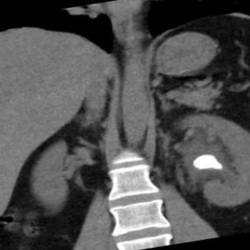</td>
<td></td>
<td></td>
</tr>
<tr>
<td>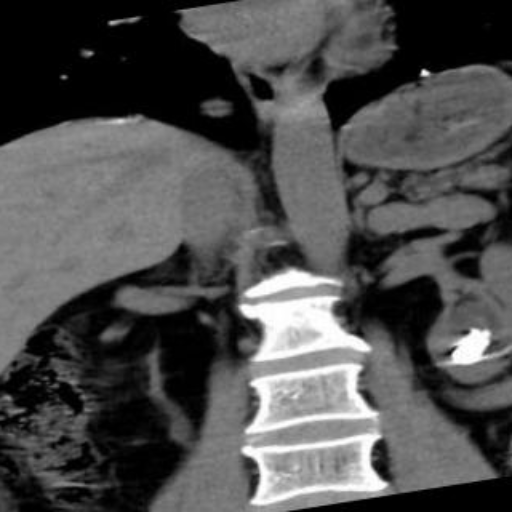</td>
<td></td>
<td></td>
</tr>
<tr>
<td>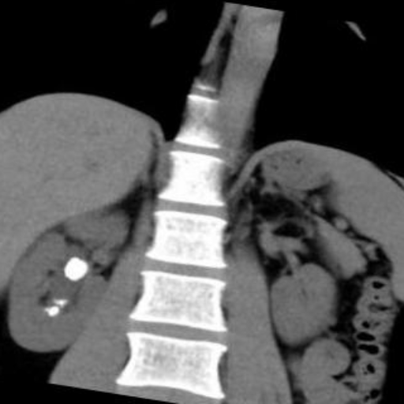</td>
<td></td>
<td></td>
</tr>
</table>

 
<h3>1. Dataset Citation</h3>
The dataset used here was taken from the following Kaggle:  
<a href="https://www.kaggle.com/datasets/bemorekgg/kidney-stone-segmentation-dataset/data">
<b>Kidney Stone Segmentation Dataset</b>
</a>  
by kildongGo.
  
The following explanation was taken the website above.
  
<b>About Dataset</b> 
<b>Overview</b> 
This dataset contains images of kidney stones with corresponding segmentation masks generated 
using the Segment Anything Model (SAM). It is designed for medical image segmentation tasks focusing on kidney stone detection and delineation.
  
<b>Dataset Contents</b> 
Images: CT scan images of kidney stones in JPG format 
Segmentation Masks: Binary masks in PNG format generated from YOLO bounding box annotations using SAM 
Text Files: Original YOLO format annotations used to guide the segmentation process  
<b>License</b> 
<a href="https://www.apache.org/licenses/LICENSE-2.0">Apache 2.0</a>
 
 
<h3>
2. Kidney-Stone-CT-Coronal ImageMask Dataset
</h3>
<h3>2.1 Download ImageMask Dataset</h3>
 If you would like to train this Kidney-Stone-CT-Coronal Segmentation model,
 please download the dataset from
<a href="https://drive.google.com/file/d/1B6IKfHphXcUi2KsaCE7KzRLFN82rhj5l/view?usp=sharing">
<b>Augmented-Kidney-Stone-CT-Coronal-ImageMask-Dataset.zip</b>
</a>.
Expand the downloaded and put it under the <b>./dataset</b> folder.
 
<pre>
./dataset
└─Kidney-Stone-CT-Coronal
    ├─test
    │   ├─images
    │   └─masks
    ├─train
    │   ├─images
    │   └─masks
    └─valid
         ├─images
         └─masks
</pre>
 
<b>Kidney-Stone-CT-Coronal Statistics</b> 
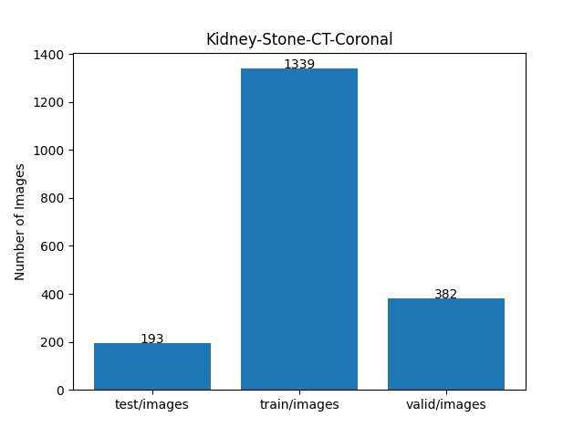 
 
As shown above, the number of images in the training and valid datasets is not so large to use for the
 training set of our segmentation model.
  
<h3>2.2 Train Sample Images and Masks</h3>
<b>Train_sample_images</b> 
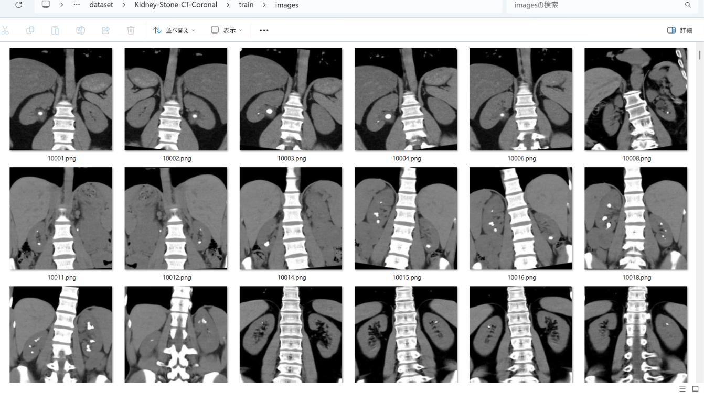
 
<b>Train_sample_masks</b> 
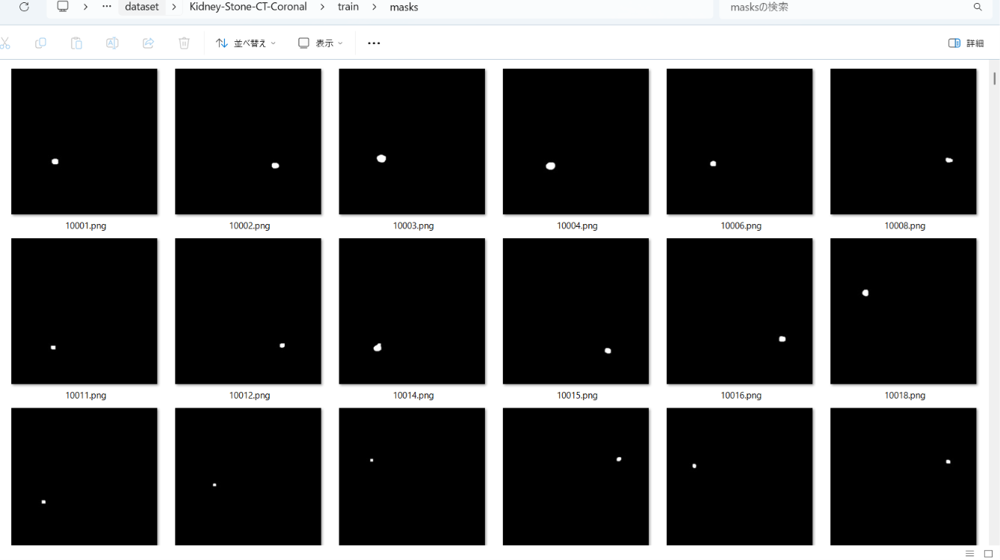
 
<h3>
3. Train TensorFlowFlexUNet Model
</h3>
 We trained the Kidney-Stone-CT-Coronal TensorFlowFlexUNet model using the following
<a href="./projects/TensorFlowFlexUNet/Kidney-Stone-CT-Coronal/train_eval_infer.config"> <b>train_eval_infer.config</b></a> file.  
Please move to ./projects/TensorFlowFlexUNet/Kidney-Stone-CT-Coronal and run the following bat file. 
<pre>
>1.train.bat
</pre>
This runs the following command. 
<pre>
>python ../../../src/TensorFlowFlexUNetTrainer.py ./train_eval_infer.config
</pre>

<b>Model parameters</b> 
Defined a small <b>base_filters=16 </b> and large <b>base_kernels=(11,11)</b> for the first Conv Layer of Encoder Block of 
<a href="./src/TensorFlowFlexUNet.py">TensorFlowFlexUNet.py</a> 
and a large <b>num_layers=8</b> (including a bridge between Encoder and Decoder Blocks).
<pre>
[model]
; You may specify your own UNet class derived from our TensorFlowFlexModel
model         = "TensorFlowFlexUNet"
generator     =  False
image_width    = 512
image_height   = 512
image_channels = 3
num_classes    = 2
base_filters   = 16
base_kernels   = (11,11)
num_layers     = 8
dropout_rate   = 0.03
dilation       = (1,1)
</pre>
<b>Learning rate</b> 
Defined a small learning rate.  
<pre>
[model]
learning_rate  = 0.00007
</pre>
<b>Loss and metrics functions</b> 
Specified "categorical_focal_dice_loss" and <a href="./src/dice_coef_multiclass.py">"dice_coef_hybrid"</a>. 
<pre>
[model]
loss           = "categorical_focal_dice_loss"
metrics        = ["dice_coef_hybrid"]
hybrid_alpha   = 1.6
hybrid_beta    = 0.4
</pre>
<b>Dataset class</b> 
Specifed <a href="./src/ImageCategorizedMaskDataset.py">ImageCategorizedMaskDataset</a> class. 
<pre>
[dataset]
class_name    = "ImageCategorizedMaskDataset"
</pre>
 
<b>Learning rate reducer callback</b> 
Enabled the learning_rate_reducer callback and a small reducer_patience.
<pre> 
[train]
learning_rate_reducer = True
reducer_factor     = 0.4
reducer_patience   = 4
</pre>
<b>Early stopping callback</b> 
Enabled early stopping callback with the patience parameter.
<pre>
[train]
patience      = 10
</pre>
<b>RGB Color map</b> 
Specified RGB color map dict for Kidney-Stone-CT-Coronal 2 classes. 
<pre>
[mask]
mask_datatype= "categorized"
mask_file_format = ".png"
; Kidney-Stone-CT-Coronal RGB color map dict for 1+1 classes.
;      Background: black,  Nodule:white
rgb_map = {(0,0,0):0,(255,255,255):1,}
</pre>

<b>Epoch change inference callback</b> 
Enabled <a href="./src/EpochChangeInferencer.py">epoch_change_infer callback</a></b>. 
<pre>
[train]
epoch_change_infer       = True
epoch_change_infer_dir   =  "./epoch_change_infer"
num_infer_images         = 6
</pre>

By using this callback, on every epoch change, the inference procedure can be called
 for 6 images in the <b>mini_test</b> folder. This will help you confirm how the predicted mask changes 
 at each epoch during your training process.  
  
<!--
As shown below, early in the model training, the predicted masks from our FlexUNet segmentation model showed 
discouraging results.
 However, as training progressed through the epochs, the predictions gradually improved. 
   
 
-->
<b>Epoch_change_inference output at starting (epoch 1,2,3)</b> 
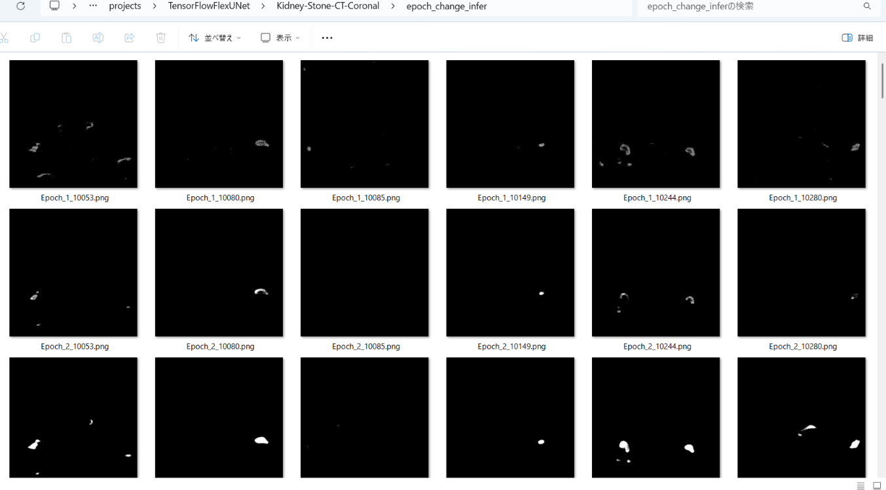 
 
<b>Epoch_change_inference output at middlepoint (epoch 24,25,26)</b> 
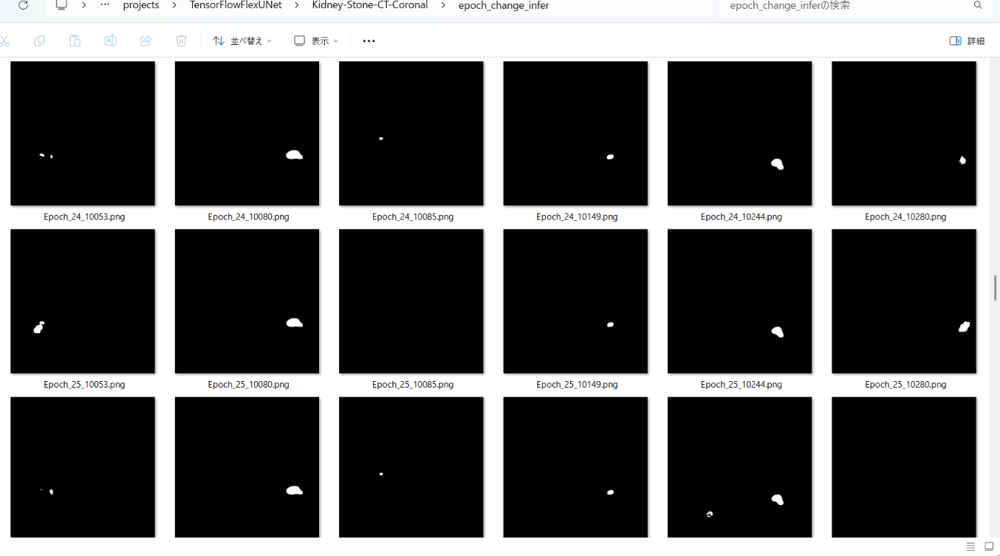 
 
<b>Epoch_change_inference output at ending (epoch 49,50,51)</b> 
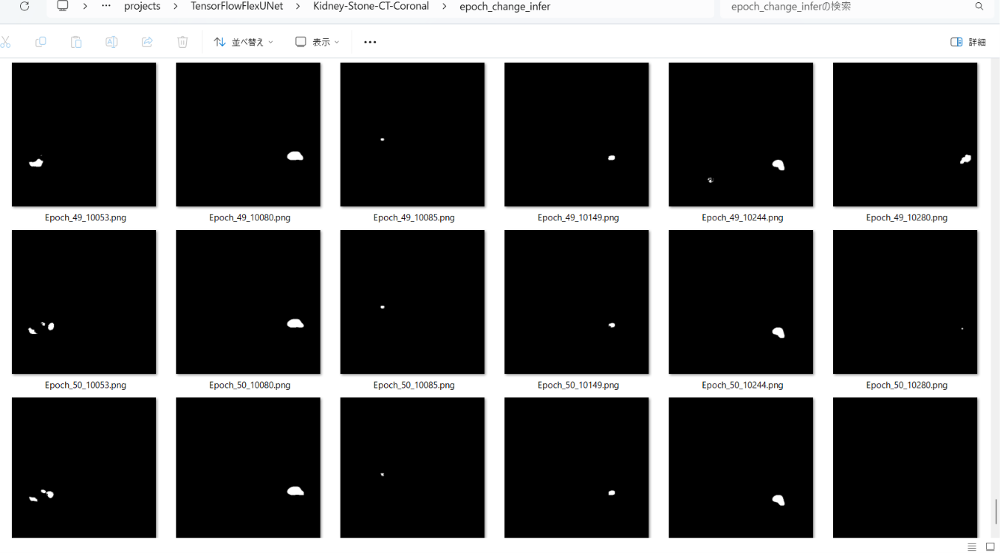 
 
In this experiment, the training process was stopped at epoch 51 by EarlyStoppingCallback. 
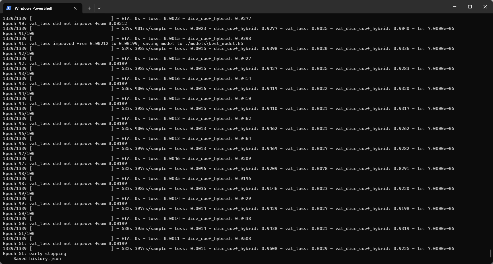 
 
<a href="./projects/TensorFlowFlexUNet/Kidney-Stone-CT-Coronal/eval/train_metrics.csv">train_metrics.csv</a> 
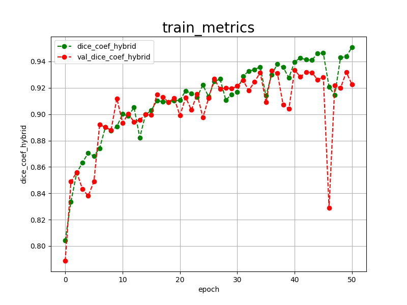 
 
<a href="./projects/TensorFlowFlexUNet/Kidney-Stone-CT-Coronal/eval/train_losses.csv">train_losses.csv</a> 
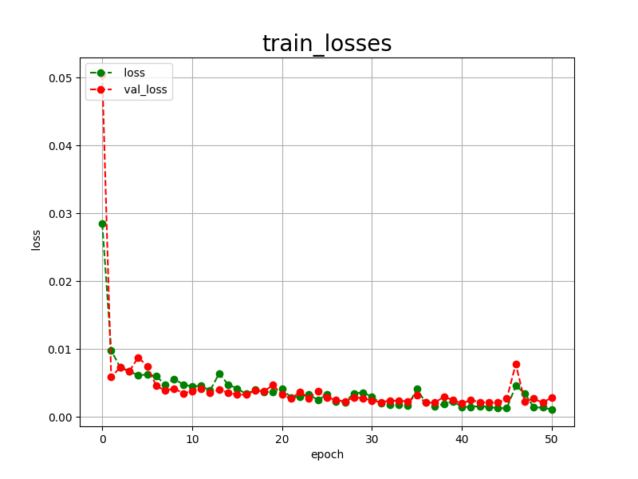 
 
<h3>
4. Evaluation
</h3>
Please move to <b>./projects/TensorFlowFlexUNet/Kidney-Stone-CT-Coronal</b> folder,
and run the following bat file to evaluate the TensorFlowUNet model for Kidney-Stone-CT-Coronal. 
<pre>
>./2.evaluate.bat
</pre>
This runs the following command.
<pre>
>python ../../../src/TensorFlowFlexUNetEvaluator.py ./train_eval_infer.config
</pre>

Evaluation console output: 
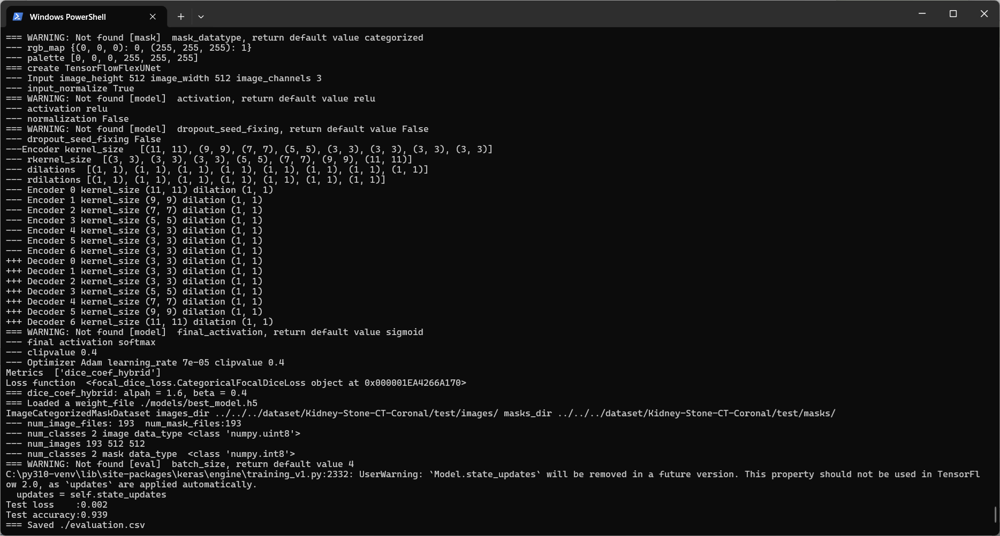
  Image-Segmentation-Kidney-Stone-CT-Coronal

<a href="./projects/TensorFlowFlexUNet/Kidney-Stone-CT-Coronal/evaluation.csv">evaluation.csv</a> 
The loss (categorical_focal_dice_loss) on this Kidney-Stone-CT-Coronal/test was very low, and dice_coef_hybrid was high, as shown below.
 
<pre>
categorical_focal_dice_loss,0.002
dice_coef_hybrid,0.939
</pre>
 
<h3>
5. Inference
</h3>
Please move to <b>./projects/TensorFlowFlexUNet/Kidney-Stone-CT-Coronal</b> folder
and run the following bat file to infer segmentation regions for images using the trained TensorFlowUNet model for Kidney-Stone-CT-Coronal. 
<pre>
>./3.infer.bat
</pre>
This runs the following command.
<pre>
>python ../../../src/TensorFlowFlexUNetInferencer.py ./train_eval_infer.config
</pre>

<b>mini_test_images</b> 
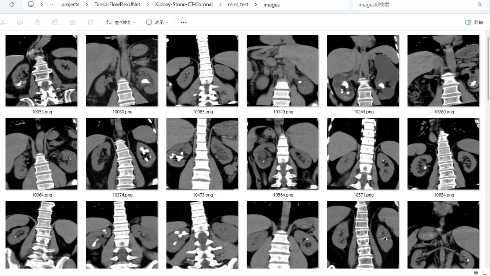 
<b>mini_test_mask(ground_truth)</b> 
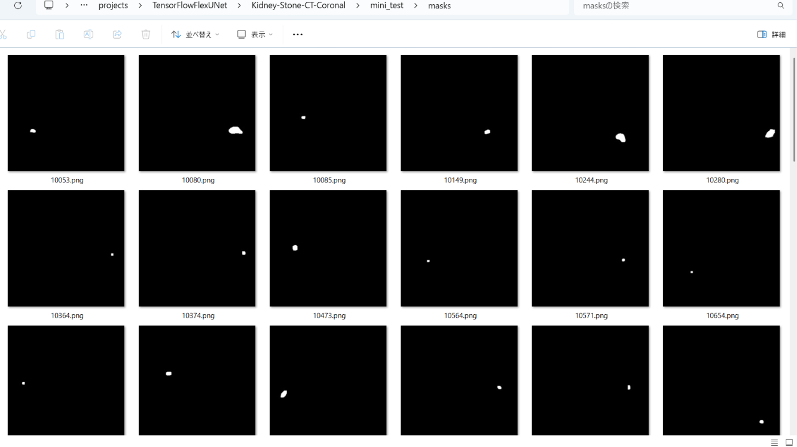 

<b>Inferred test masks</b> 
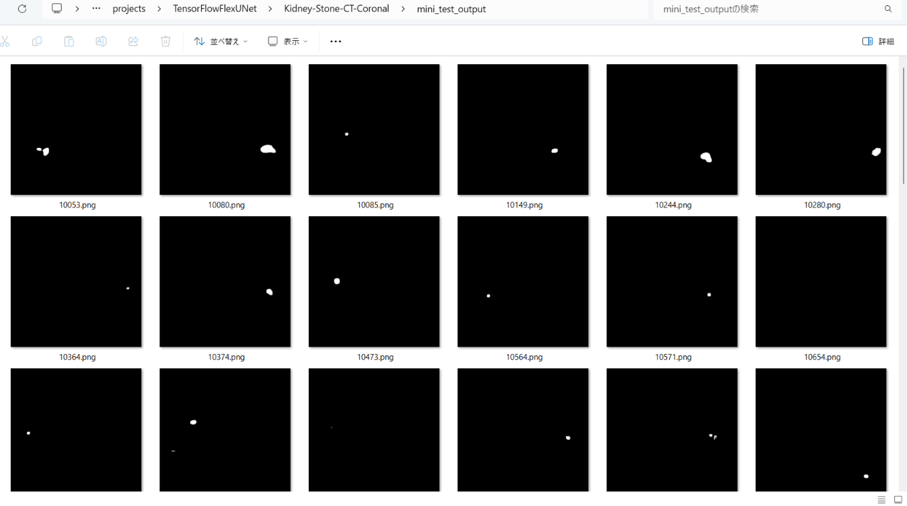 
 

<b>Enlarged images and masks for Kidney-Stone-CT-Coronal Images of 512x512 pixels</b> 
As shown below, the inferred masks look similar to the ground truth masks except for the third and sixth cases. 
 
<table>
<tr>
<th width="320" height="auto">Image</th>
<th width="320" height="auto">Mask (ground_truth)</th>
<th width="320" height="auto">Inferred-mask</th>
</tr>
<tr>
<td></td>
<td></td>
<td></td>
</tr>
<tr>
<td>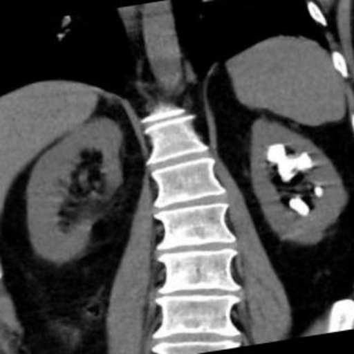</td>
<td></td>
<td></td>
</tr>
<tr>
<td>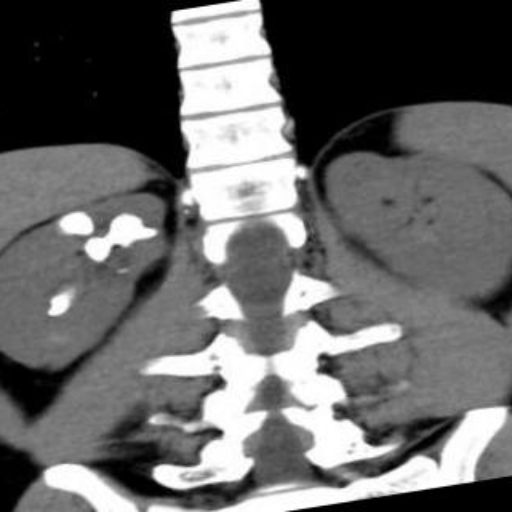</td>
<td></td>
<td></td>
</tr>
<tr>
<td>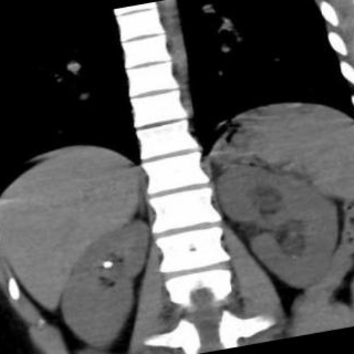</td>
<td></td>
<td></td>
</tr>
<tr>
<td>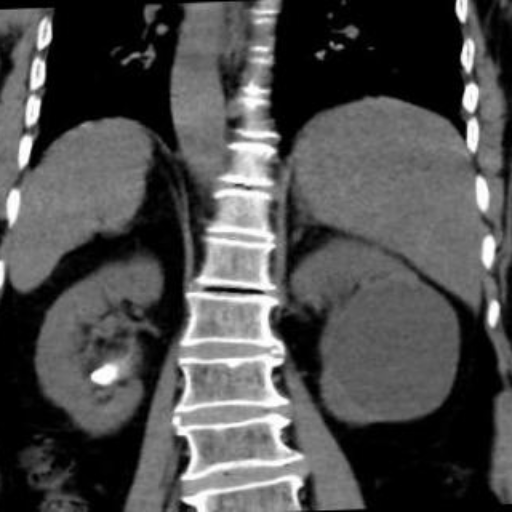</td>
<td></td>
<td></td>
</tr>
<tr>
<td>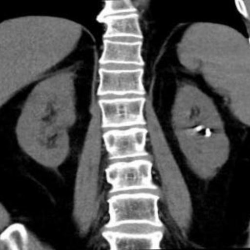</td>
<td></td>
<td>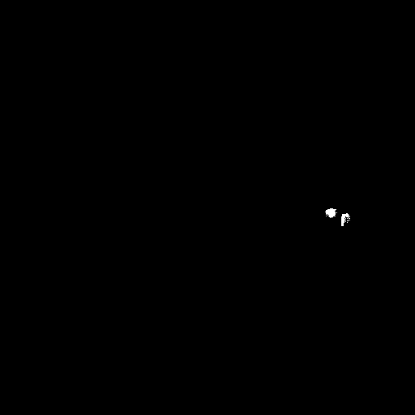</td>
</tr>
</table>

 
<h3>
References
</h3>
<b>1.  TensorFlow-FlexUNet-Image-Segmentation-KSSD2025-Kidney-Stone-CT</b> 
Toshiyuki Arai 
<a href="https://github.com/sarah-antillia/TensorFlow-FlexUNet-Image-Segmentation-KSSD2025-Kidney-Stone-CT">
https://github.com/sarah-antillia/TensorFlow-FlexUNet-Image-Segmentation-KSSD2025-Kidney-Stone-CT
</a>
  
<b>2. TensorFlow-FlexUNet-Image-Segmentation-Kidney-Stone-CT-Axial</b> 
Toshiyuki Arai 
<a href="https://github.com/sarah-antillia/TensorFlow-FlexUNet-Image-Segmentation-Kidney-Stone-CT-Axial">
https://github.com/sarah-antillia/TensorFlow-FlexUNet-Image-Segmentation-Kidney-Stone-CT-Axial
</a>
  
<b>3. TensorFlow-FlexUNet-Image-Segmentation-Model</b> 
Toshiyuki Arai 
<a href="https://github.com/sarah-antillia/TensorFlow-FlexUNet-Image-Segmentation-Model">
https://github.com/sarah-antillia/TensorFlow-FlexUNet-Image-Segmentation-Model
</a>
  
